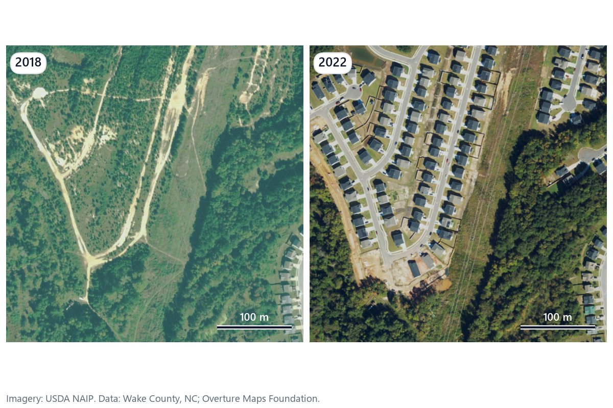

# ParcelWatch

**Find the buildings the tax roll missed.** ParcelWatch compares two dates of free USDA NAIP aerial imagery, detects every building on both, labels each parcel's change (new, expanded, demolished) and flags the parcels with a new building and no building permit on file. That's the service US county assessors buy from imagery vendors, because unpermitted construction never reaches the tax roll.



## Result: east Wake County, NC, 2018 to 2022 (25 km² pilot)

| | |
| --- | --- |
| Parcels in the study box | 5,667 |
| Parcels with detected building change | 1,400 |
| Of those, with a new building and no building permit in the window | **325** |
| New building area on flagged parcels | 883,100 sq ft |
| Estimated missed tax, raw | $1.24 million / yr |
| Precision of flags (200-parcel check, see below) | **59%** (10 of 17 confirmed) |
| Estimated missed tax, adjusted for precision | **$731,000 / yr** |

> **Status (2026-11-02):** the full pipeline runs end to end on real data with the fine-tuned v1 model, which replaced the pretrained v0 baseline after beating it on the same 200 parcels. Only new buildings raise a flag; expansions and demolitions are still detected and counted, but the accuracy check showed those flags were almost never real. The 200 validation parcels were labeled blind by Claude from before/after image chips and accepted by the owner; that's an image review, not a field check.

### What the accuracy check says

The 200-parcel check (100 flagged, 100 unchanged, drawn with `random_state=42` from the v0 baseline's results and labeled blind from 2018/2022 image chips) scores both models on the same parcels, each with its own flags:

| | v0 (pretrained) | v1 (fine-tuned, in use) |
| --- | --- | --- |
| Sample parcels flagged | 57 | 17 |
| Confirmed as real change | 19 | 10 |
| Precision | 33% | **59%** |
| Miss rate in the rest of the sample | 10% | 13% |
| False alarms from trees | 22 | 6 |

Why only new buildings flag: under the first rule, where any change could flag a parcel, "expanded" and "demolished only" flags were 1 of 44 real for v0 and 0 of 14 for v1. The model draws the same roof a little differently each year, 20 m² is a small margin at 0.6 m pixels, and trees hide roofs in one year. Dropping those flags took v1 from 32% to 59% precision (v0 from 20% to 33%) and halved the flag count; the tax estimate counts new building area only.

What the numbers don't say: 17 flags is a small sample, so the 59% has wide error bars (roughly 36% to 78% at 95% confidence). v1 also flags fewer real changes than v0 (10 of v0's 19 confirmed ones), and v1's flags outside the 200 parcels weren't checked, because the sample was drawn before v1 existed. Precision is still below the 70% target and the miss rate above the 10% target, and both are reported as they stand.

## How it works

1. **Download.** NAIP 2018 (flown 2018-10-22) and 2022 (2022-09-27 and 2022-10-06) from Microsoft Planetary Computer, read as windows of the cloud-optimized tiles. Wake County parcels, building permits and town limits from ArcGIS Hub. Overture building footprints for training labels. Owner, mailing address and site address columns are never read.
2. **Prepare.** Both years go onto one 0.6 m grid in NAD83 / UTM 17N. The offset between years is measured at 5 road intersections that exist in both years (automatic phase-correlation estimate, accepted by the owner: 4.4 m max), giving a 5.4 m match tolerance. The 2018 image is histogram-matched to 2022 as detector input, because the pretrained model found half as many 2018 houses on the hazier original.
3. **Detect.** The same model with the same settings on both years: GeoAI's pretrained building extractor (v0), then a 4-band Mask R-CNN fine-tuned on Overture labels (v1). v1 replaces v0 only if it's at least as precise on the same 200 parcels.
4. **Compare buildings, not pixels.** NAIP is accurate to about ±6 m, so pixel differencing would light up every roof edge. A 2022 building with no 2018 match is new; +20 m² and 1.2× the old area is expanded; a 2018 building with no 2022 match is demolished.
5. **Check permits.** A changed parcel is permitted if a building-related permit issued between 2017-10-22 and 2022-10-06 sits inside it or carries its parcel number (1,898 such permits in the box). A parcel is flagged when it has a new building and no such permit.
6. **Price and publish.** Value per sq ft is the median `BLDG_VAL / HEATEDAREA` of 1,103 homes built since 2021 in the box ($172.25). Tax uses 2026 rates (county 53.71¢ per $100, plus Wendell 42.00¢ or Knightdale 44.00¢), fire tax excluded, then multiplied by measured precision. The public map shows H3 hexagons with at least 5 parcels; no parcel, address or owner is ever published.

## Run it yourself

```bash
uv venv --python 3.11 .venv          # or: conda env create -f environment.yml
source .venv/Scripts/activate        # Windows Git Bash; .venv/bin/activate elsewhere
uv pip install -e ".[dev,ml]"

parcelwatch download --config configs/wake_pilot.yaml   # ~600 MB
parcelwatch prepare  --config configs/wake_pilot.yaml
parcelwatch detect   --config configs/wake_pilot.yaml --model v0   # ~35 min on CPU
python scripts/train_v1_local.py                         # v1: ~7.5 h on a 4 GB GPU (or Colab)
parcelwatch detect   --config configs/wake_pilot.yaml --model v1   # ~13 min on GPU
parcelwatch changes  --config configs/wake_pilot.yaml --model v1
parcelwatch validate --config configs/wake_pilot.yaml --make-sheet  # then label, then --score
parcelwatch report   --config configs/wake_pilot.yaml
pytest -q                                                # 89 tests, no network or GPU
```

Every number, URL, date and field name lives in `configs/wake_pilot.yaml`. Another county is a new config file. Design and decisions: `CLAUDE.md`, `docs/PRD.md`, `docs/TRD.md`, `docs/DESIGN.md`.

## Limitations

- Flags are leads from aerial imagery, not findings. A field review is needed before any action.
- Only new buildings are flagged. Unpermitted additions and demolitions exist but can't be told apart from outline noise at NAIP's resolution, so they're left out. Trees and shadows cause both false alarms and misses.
- Additions under 20 m² can't be told apart from noise at NAIP's resolution and accuracy.
- Only roofed buildings count: no pools, decks, patios or interior work.
- A permit anywhere in the window covers the whole parcel.
- One value per sq ft for the whole area; real assessments vary by house.

## Credits and license

Imagery: USDA NAIP. Data: Wake County, NC (CC BY 4.0); Overture Maps Foundation (ODbL). Code: MIT, © 2026 Muhammad Shahid Usman (mapsync360@gmail.com).
