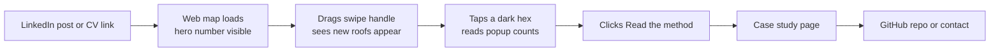

# DESIGN: ParcelWatch Design System, UI and UX

Version 0.1 · 2026-10-25 · Owner: Muhammad Shahid Usman
Source of truth for how ParcelWatch looks and behaves: the public web map, the case study page, the private parcel review table, and every static figure. Use these tokens exactly. Don't invent new colors, fonts or sizes.

## 1. Design principles

1. **Result first.** The first screen shows the headline number and the before/after imagery. Method comes after.
2. **The imagery is the hero.** UI chrome stays quiet and neutral so roofs and change colors are what the eye finds.
3. **Honest numbers.** Every money figure says "estimated" and shows the precision it's adjusted by. Limitations are one click away, never hidden.
4. **Never accuse.** Public views show areas (hexagons), never parcels or addresses. Wording says "unpermitted change detected", never "illegal" or "violation".
5. **Colorblind-safe, always.** Change types never rely on color alone.

## 2. Brand

- **Name:** ParcelWatch (one word, capital P and W).
- **Tagline:** "Find the buildings the tax roll missed."
- **Logo (v1):** wordmark only, "Parcel" in Inter 600 + "Watch" in Inter 400, ink color, preceded by a 16 px square outline icon with a filled corner (a parcel with a new building). No mascot, no gradients.
- **Voice:** plain, specific, confident. Short sentences. Numbers instead of adjectives. Example: "312 parcels gained 410 sq ft on average with no permit on file."

## 3. Color tokens

Defined as CSS custom properties on `:root`, with a dark override under `@media (prefers-color-scheme: dark)` and `[data-theme="dark"]`.

### 3.1 Neutrals and UI

| Token | Light | Dark | Use |
| --- | --- | --- | --- |
| `--bg` | `#FFFFFF` | `#0B0F14` | Page background |
| `--surface` | `#F6F7F9` | `#141A21` | Panels, cards |
| `--surface-raised` | `#FFFFFF` | `#1B232C` | Popups, drawers |
| `--border` | `#E3E6EA` | `#2A333D` | Dividers, card borders |
| `--ink` | `#0F172A` | `#E6EAF0` | Primary text |
| `--ink-muted` | `#5B6676` | `#9AA5B4` | Secondary text, labels |
| `--accent` | `#0F766E` | `#2DD4BF` | Links, focus ring, active controls |
| `--accent-ink` | `#FFFFFF` | `#0B0F14` | Text on accent |
| `--focus` | `#0F766E` | `#2DD4BF` | 2 px focus outline, 2 px offset |
| `--success` | `#15803D` | `#4ADE80` | Validation "correct" |
| `--warning` | `#B45309` | `#FBBF24` | Caveats, low-confidence notes |
| `--danger` | `#B91C1C` | `#F87171` | Errors only (never for map data) |

### 3.2 Change-type colors (Okabe-Ito, colorblind-safe, same in both themes)

| Change | Token | Hex | Shape in legend and tables |
| --- | --- | --- | --- |
| New building | `--chg-new` | `#D55E00` | Filled square ■ |
| Expanded | `--chg-expanded` | `#E69F00` | Half-filled square ◧ |
| Demolished | `--chg-demolished` | `#0072B2` | Outlined square □ with diagonal |
| Unchanged | `--chg-unchanged` | `#8A94A3` | Thin outline, 40% opacity |
| Unpermitted flag | `--chg-flag` | `#CC79A7` | 2 px dashed outline around the parcel (private view only) |

Building polygons on imagery: fill at 35% opacity, 1.5 px stroke at 100%.

### 3.3 Hex density ramp (public map, `n_flagged` per hex)

Sequential, 5 classes, quantile breaks computed at build time and written to `stats.json`.

| Class | Hex |
| --- | --- |
| 1 (lowest) | `#FEF0D9` |
| 2 | `#FDCC8A` |
| 3 | `#FC8D59` |
| 4 | `#E34A33` |
| 5 (highest) | `#B30000` |

Hex fill opacity 0.65 over imagery, 0.85 over the light basemap. Hex stroke `--bg` at 0.5 px. Hexes with 0 flags are not drawn.

All text and UI colors meet WCAG 2.2 AA (4.5:1 for body text, 3:1 for large text and UI controls) against their backgrounds.

## 4. Typography

| Role | Font | Weight | Size / line height | Notes |
| --- | --- | --- | --- | --- |
| Display (hero number) | Inter | 700 | 48 / 52 px desktop, 36 / 40 mobile | Tabular figures (`font-feature-settings: "tnum"`) |
| H1 | Inter | 700 | 32 / 40 | Case study title |
| H2 | Inter | 600 | 24 / 32 | Section heads |
| H3 | Inter | 600 | 18 / 26 | Panel titles |
| Body | Inter | 400 | 16 / 26 | Max line length 68 characters |
| Small / label | Inter | 500 | 13 / 18 | Legend, control labels, `--ink-muted` |
| Caption | Inter | 400 | 12 / 16 | Attribution, footnotes |
| Data and code | IBM Plex Mono | 400 / 500 | 14 / 20 | Numbers in tables, parcel IDs, code blocks |

Load from Google Fonts: Inter (400, 500, 600, 700), IBM Plex Mono (400, 500), with `font-display: swap`. Fallback stack: `Inter, system-ui, -apple-system, "Segoe UI", Roboto, sans-serif`.

Numbers: thousands separators always (`12,480`), money as `$32,600` (no decimals over $100), areas as `410 sq ft`, percentages as whole numbers (`74%`).

## 5. Spacing, layout and shape

- **Base unit 4 px.** Scale: 4, 8, 12, 16, 24, 32, 48, 64.
- **Radius:** 8 px cards and panels, 6 px buttons and inputs, 999 px pills and chips.
- **Shadow:** one level only, `0 4px 16px rgba(15, 23, 42, 0.12)` for floating panels. None on cards.
- **Breakpoints:** mobile < 640 px, tablet 640 to 1023 px, desktop ≥ 1024 px.
- **Page gutter:** 16 px mobile, 24 px tablet, 32 px desktop. No horizontal scroll at 360 px width.
- **Touch targets:** at least 44 × 44 px.

## 6. Screens and layout

### 6.1 Public web map (`web/index.html`)

Desktop:

```text
┌──────────────────────────────────────────────────────────────────┐
│ ▣ ParcelWatch      Wake County, NC · 2018 → 2022    [About] [◐] │  Top bar, 56 px
├───────────────────┬──────────────────────────────────────────────┤
│ STATS PANEL 360px │                                              │
│ 312               │          MAP (full height)                   │
│ parcels with      │     2018  ◀────── swipe ──────▶  2022        │
│ unpermitted change│                                              │
│ ───────────────── │                           ┌──────────────┐   │
│ ■ New        204  │                           │ LEGEND       │   │
│ ◧ Expanded    96  │                           │ Flagged/hex  │   │
│ □ Demolished  41  │                           │ ▢▢▢▢▢ 1 → 20 │   │
│ ───────────────── │                           └──────────────┘   │
│ Est. missed tax   │                                              │
│ $32,600 / yr      │                                  [+][-][⌖]  │
│ adjusted for 74%  │                                              │
│ precision  ⓘ      │                                              │
│ [Read the method] │ Imagery: USDA NAIP · Data: Wake County, NC,  │
│                   │ Overture Maps                                │
└───────────────────┴──────────────────────────────────────────────┘
```

(Numbers above are placeholders for layout only.)

Mobile: stats panel becomes a bottom sheet with 3 snap points (peek 120 px showing the hero number, half, full). Map stays full screen behind it.

### 6.2 Case study page (`web/case-study.html`)

Single column, max width 720 px. Order is fixed:

1. H1 + one-sentence result
2. Hero number row (3 stat tiles: flagged parcels, precision, estimated yearly tax)
3. Before/after swipe image of one example neighborhood (hex-level, no parcel IDs)
4. "How it works" pipeline diagram (6 steps, matches TRD section 1)
5. Accuracy: confusion counts + false-alarm causes bar chart
6. Money: formula and assumptions
7. Limitations (always visible, not collapsed)
8. Applying this elsewhere (US counties, Gulf municipalities)
9. Links: GitHub repo, web map, contact

### 6.3 Private parcel review table (`results/review.html`, never deployed)

Sorted by estimated yearly tax, descending. Columns: Rank · Parcel ID (mono) · Change (shape + label) · Added sq ft · Permits in window · Est. yearly tax · Before chip · After chip · Reviewer verdict (dropdown: Confirmed / False alarm / Unsure) · Note. Row height 96 px to fit 80 × 80 px image chips.

## 7. UI components

| Component | Spec | States |
| --- | --- | --- |
| **Top bar** | 56 px, `--bg`, bottom border `--border`. Wordmark left, study label center (desktop only), actions right | Default |
| **Swipe compare** | Vertical divider 2 px `--ink` with a 40 px round handle (`--surface-raised`, shadow, ◀▶ glyph). Year labels pinned at top of each side as pills | Idle, hover (handle scales 1.1), dragging, keyboard (←/→ move 5%, Home/End to edges) |
| **Stat tile** | Label (Small, muted) above value (Display or H2, tabular mono for numbers), optional footnote (Caption) | Default, loading (skeleton bar) |
| **Change count row** | Shape glyph in change color + label + right-aligned count (Plex Mono) | Default, hover highlights matching features on map |
| **Legend** | Floating card, 8 px radius, 12 px padding, bottom-left on desktop, collapsible chip on mobile | Expanded, collapsed |
| **Layer toggle** | Pill toggles: "Flag density" (default on), "2018 imagery", "2022 imagery" | On (accent fill), off (outline), focus |
| **Hex popup** | On click/tap: n parcels, n changed, n flagged, added sq ft. Never parcel IDs | Open, closed (Esc or click outside) |
| **Info tooltip ⓘ** | 280 px max width, Caption text, opens on hover and focus, closes on Esc | |
| **Method drawer** | Right-side drawer 420 px (full screen on mobile) with the 6 pipeline steps and limitations | Open, closed |
| **Theme toggle ◐** | Cycles system → light → dark, stored in `localStorage` (wrapped in try/catch) | |
| **Primary button** | `--accent` fill, `--accent-ink` text, 40 px tall, 16 px horizontal padding | Default, hover (8% darker), active, focus ring, disabled (40% opacity) |
| **Secondary button** | Transparent, 1 px `--border`, `--ink` text | Same states |
| **Loading** | Skeleton blocks in `--surface`, 1.2 s shimmer; map shows "Loading imagery…" caption | |
| **Empty / error** | Plain sentence + retry button. Example: "Couldn't load the map tiles. Check your connection and try again." | |

## 8. User flows

### Flow A: Recruiter, 2 minutes (primary)



Success: hero number and swipe understood within 10 seconds without reading instructions.

### Flow B: Assessor demo, 15 minutes (private, screen-shared)

1. Owner opens the public map to show scale.
2. Switches to the private review table, sorted by estimated tax.
3. Opens the top 5 parcels: before chip, after chip, permit count = 0.
4. Shows the validation result and false-alarm causes.
5. Ends on the money slide: precision-adjusted yearly tax and the full-county projection, labeled "projection".

### Flow C: Technical reviewer

README → "Run it yourself" section → `conda env create` → `parcelwatch download/prepare/changes` on the bundled tiny fixture → tests pass → reads TRD.

### Flow D: Mobile visitor

Map with bottom sheet at peek height showing the hero number → swipe works with one finger on the handle (map pan uses the rest of the screen) → sheet pulls up for stats and method link.

## 9. Interaction and motion

- Map initial view: fits the study bbox with 24 px padding, pitch 0, no rotation (rotation disabled).
- Transitions 150 ms ease-out for UI, 400 ms for map fly-to. Respect `prefers-reduced-motion`: no fly-to animation, no shimmer.
- Hover on a change-count row highlights matching map features for as long as the pointer is there.
- All controls reachable by keyboard in visual order. Visible focus ring always.
- Every map layer has a text alternative: the stats panel itself, plus `aria-label` on the map container describing the study area and years.

## 10. Static figures (README, case study, slides)

- Made with matplotlib using a `parcelwatch.mplstyle` file that sets Inter, the tokens above, 150 dpi, white background, no top/right spines, light grid in `--border`.
- Sizes: 1600 × 900 px for slides and LinkedIn, 1200 × 800 for README.
- Before/after pairs: identical extent and scale, year labels as pills in the top-left, a 100 m scale bar bottom-right, north arrow only if the map is rotated (it never is).
- Charts: bar charts for false-alarm causes (sorted descending, labeled bars, no legend), never pie charts.
- Every figure carries a caption line: "Imagery: USDA NAIP. Data: Wake County, NC; Overture Maps Foundation."

## 11. Content and microcopy

| Context | Use | Avoid |
| --- | --- | --- |
| Flag label | "Unpermitted change detected" | "Illegal", "violation", "tax cheat" |
| Money | "Estimated missed tax" + "adjusted for 74% precision" | Unqualified dollar totals |
| Accuracy | "74 of 100 flags confirmed by hand review" | "74% accurate" alone |
| Disclaimer (map footer and case study) | "Flags are leads from aerial imagery, not findings. A field review is needed before any action." | |
| Empty hex popup | "No unpermitted change detected here." | |

## 12. Accessibility checklist (must pass before launch)

- [ ] Text contrast AA in both themes
- [ ] Change types distinguishable in grayscale (shape glyphs present)
- [ ] Full keyboard operation, including swipe handle
- [ ] `prefers-reduced-motion` respected
- [ ] Works at 360 px wide with no horizontal scroll
- [ ] Lighthouse accessibility ≥ 95
