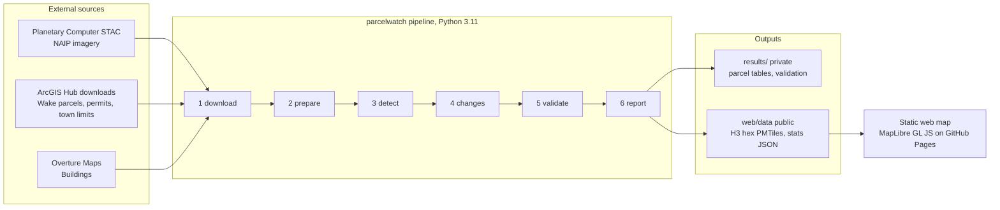

# TRD: ParcelWatch Technical Requirements

Version 0.1 · 2026-10-25 · Owner: Muhammad Shahid Usman
Source of truth for *how* ParcelWatch is built. Every number here must match `configs/wake_pilot.yaml`. If it doesn't, the config wins and this file gets fixed.

## 1. System overview

ParcelWatch v1 is a **batch pipeline plus a static website**. There's no running server, no database server and no user accounts. The pipeline runs on demand from a CLI, writes files, and the website reads pre-built tiles.



**Compute split:** steps 1, 2, 4, 5, 6 run on the owner's Windows laptop. Step 3 (detection and training) runs on Google Colab with a T4 GPU, reading and writing through Google Drive.

## 2. Tech stack (locked)

| Layer | Choice | Version policy |
| --- | --- | --- |
| Language | Python 3.11 | Pinned |
| Env | conda env `parcelwatch` + `pyproject.toml` | Pin exact versions in `requirements.lock` after first working run |
| Geo core | geopandas, shapely 2, rasterio, rioxarray, pyproj | Latest stable at lock time |
| Imagery access | pystac-client, planetary-computer | |
| GeoAI | geoai-py (opengeos), torch, torchvision | |
| Vectors | overturemaps, requests | |
| Hexagons | h3 (v4 API) | |
| CLI | typer | |
| Config | pydantic v2 models loaded from YAML | |
| Tests | pytest, pytest-cov | |
| Lint and format | ruff (lint + format), mypy (basic) | |
| Notebooks | jupyter, leafmap (exploration and figures only) | |
| Tiles | tippecanoe → PMTiles | |
| Web | Plain HTML + TypeScript-free vanilla JS, MapLibre GL JS, pmtiles JS, no framework | Versions pinned in `web/index.html` |

## 3. Modules and functions

All code lives in `src/parcelwatch/`. Notebooks import from here and never define pipeline logic.

| Module | Key functions | Input | Output |
| --- | --- | --- | --- |
| `config.py` | `load_config(path) -> Config` | YAML | Validated pydantic `Config` |
| `download.py` | `download_naip_items(item_ids, out_dir)`, `download_hub_file(url, out)`, `load_parcels(zip, bbox, cfg)`, `load_permits(csv, bbox, window, cfg)`, `download_overture(bbox, out)` | Config | `data/raw/naip_{before,after}/*.tif`, `wake_parcels.zip`, `wake_permits.csv`, `wake_corporate_limits.geojson`, `overture_buildings.parquet` |
| `prepare.py` | `mosaic(folder, out)`, `align_to(reference, target, out)`, `clip_vectors(aoi, crs)`, `measure_offset(before, after, points)` | Raw files | `data/processed/naip_before.tif`, `naip_after_aligned.tif`, clipped vectors, `results/alignment_report.json` |
| `detect.py` | `run_v0(image, out)`, `make_training_tiles(image, labels)`, `train_v1(...)`, `run_v1(image, model, out)` | Processed images | `results/buildings_{before,after}_{v0,v1}.gpkg` |
| `changes.py` | `classify_changes(before, after, cfg) -> (after_labeled, demolished)`, `rollup_to_parcels(changes, parcels)`, `attach_permits(parcel_changes, permits, window)` | Building layers, parcels, permits | `results/building_changes.gpkg`, `results/parcel_changes.gpkg` |
| `validate.py` | `make_sample_sheet(parcel_changes, parcels)`, `compute_metrics(sheet) -> Metrics` | Parcel changes + labeled CSV (owner, or accepted Claude review) | `results/validation_sheet.csv`, `results/metrics.json` |
| `valuation.py` | `value_per_sqft(parcels, years)`, `estimate_missed_tax(parcel_changes, precision, cfg)` | Parcel changes, metrics | `results/valuation.json` |
| `publish.py` | `to_h3(parcel_changes, res, min_parcels)`, `export_pmtiles(gdf, out)`, `write_stats(json)` | Parcel changes | `web/data/changes_h3.pmtiles`, `web/data/stats.json` |
| `cli.py` | `download`, `prepare`, `detect`, `changes`, `validate`, `report` | Config path | Calls the modules above |

### 3.1 Core algorithms (locked)

**Change classification** (`changes.classify_changes`), all geometry in EPSG:26917:

1. Drop buildings smaller than `min_building_area_m2` (10.0) in both years.
2. Buffer Before buildings by `match_tolerance_m` (3.0). Spatially join After buildings to them (`intersects`).
3. For each After building: no match → `new`. Matched and (`after_area − matched_before_area ≥ 20.0 m²` **and** `after_area ≥ 1.2 × matched_before_area`) → `expanded`. Otherwise → `unchanged`.
4. `added_m2 = max(after_area − matched_before_area, 0)` for new and expanded, else 0.
5. Before buildings that intersect no buffered After building → `demolished`.

**Parcel roll-up:** assign each building to a parcel by its `representative_point()` falling `within` the parcel. One building = one parcel, always.

**Permit check:** permit window = **2017-10-22 to 2022-10-06** (12 months before the 2018-10-22 Before image, through the 2022-10-06 After image). Parse `ISSUE_DATE` with format `%Y/%m/%d %H:%M:%S%z`. Keep only the building-related `PERMIT_TYPE` values listed in the config. Permit points come from `X` (longitude) and `Y` (latitude) in EPSG:4326. A permit matches a parcel if its point falls **within** the parcel **or** its `PIN` equals the parcel's `PIN_NUM`; either counts. `flag_unpermitted = n_permits == 0`.

**Parcel loading:** read the full-county shapefile zip (EPSG:2264), drop `OWNER`, `ADDR1`, `ADDR2`, `ADDR3` immediately, clip to the box, reproject to EPSG:26917, run `make_valid`.

**Alignment tolerance:** measure Before/After offset at 5 road intersections; `tolerance = clamp(max_offset + 1.0, 3.0, 6.0)` meters; written to `results/alignment_report.json` and read by `classify_changes`.

**Model promotion:** v1 replaces v0 only if v1's precision on the 200-parcel validation sample is at least v0's. Otherwise keep v0 and document why.

**Valuation:**

```
value_per_sqft   = median(BLDG_VAL / HEATEDAREA) over parcels in the box with YEAR_BUILT >= 2021,
                   HEATEDAREA >= 600 and BLDG_VAL > 0 (fewer than 30 such parcels → use all of Wake County)
missed_value     = added_sqft × value_per_sqft × assessment_ratio (1.0)
rate_cents       = 53.71 (county) + town rate by CITY_DECODE (WENDELL 42.00, KNIGHTDALE 44.00, else 0)
yearly_tax       = missed_value × rate_cents / 100 / 100        # rates are cents per $100; fire tax excluded
reported_tax     = sum(yearly_tax of flagged parcels) × measured_precision
```

## 4. Data contracts

Every output file follows these schemas. Column names are snake_case. CRS is EPSG:26917 unless stated.

**`building_changes.gpkg`** (layer `buildings`)

| Column | Type | Notes |
| --- | --- | --- |
| `bldg_id` | str | `"{year}_{index}"` |
| `year` | int | Image year the polygon came from |
| `change` | str enum | `new`, `expanded`, `unchanged`, `demolished` |
| `area_m2` | float | Polygon area |
| `matched_before_m2` | float, nullable | Sum of matched Before areas |
| `added_m2` | float | ≥ 0 |
| `model` | str | `v0` or `v1` |
| `score` | float, nullable | Model confidence if available |
| `geometry` | Polygon | |

**`parcel_changes.gpkg`** (layer `parcels`) · PRIVATE, never published

| Column | Type | Notes |
| --- | --- | --- |
| `parcel_id` | str | From `PIN_NUM` |
| `city` | str | From `CITY_DECODE`; drives the town tax rate |
| `n_new`, `n_expanded`, `n_demolished` | int | |
| `added_m2`, `added_sqft` | float | sqft = m² × 10.764 |
| `n_permits` | int | In window |
| `flag_unpermitted` | bool | |
| `value_per_sqft` | float | County median, same for all rows in v1 |
| `est_missed_value_usd` | float | Raw, not precision-adjusted |
| `est_yearly_tax_usd` | float | Raw |
| `rank` | int | 1 = highest `est_yearly_tax_usd` among flagged |
| `geometry` | Polygon | Parcel boundary |

**`changes_h3` (web)** · PUBLIC, EPSG:4326

| Column | Type | Notes |
| --- | --- | --- |
| `h3` | str | Resolution 9 cell |
| `n_parcels` | int | Parcels in hex. Hexes with < 5 parcels are dropped |
| `n_changed` | int | Parcels with any change |
| `n_flagged` | int | Parcels with `flag_unpermitted` |
| `added_sqft` | float | Rounded to nearest 100 |

**`stats.json`** (web): `{ "area_km2", "before_year", "after_year", "n_new", "n_expanded", "n_demolished", "n_flagged", "precision", "miss_rate", "est_yearly_tax_usd_adjusted", "generated_at" }`

**`metrics.json`**: `{ "n_sample", "tp", "fp", "fn", "tn", "precision", "miss_rate", "false_alarm_causes": {cause: count} }`

## 5. Integrations

| Integration | Endpoint | Auth | Limits and handling |
| --- | --- | --- | --- |
| Microsoft Planetary Computer STAC | `https://planetarycomputer.microsoft.com/api/stac/v1`, collection `naip` | None required. Optional key via env `PC_SDK_SUBSCRIPTION_KEY` | Signed URLs expire, so sign right before reading. Retry 3 times with exponential backoff (2, 4, 8 s) |
| Wake County Parcels | ArcGIS Hub item `f5ed009c66e844ec82f29064edd95017`, shapefile zip (176 MB, EPSG:2264, 439,400 parcels) | None | Full-county file, downloaded once, clipped locally. `maps.wake.gov` refuses connections from Pakistan and Hub's *filtered* downloads also fail (404), so never use either |
| Wake County Building Permits | ArcGIS Hub item `6a9651b339b7413d8dc264f9ae1b3f6f`, CSV (~95 MB, 196,790 permits since 1973) | None | Full file once. `X`/`Y` are lon/lat. Dates as text `YYYY/MM/DD 00:00:00+00` |
| Wake County Corporate Limits | ArcGIS Hub item `611072be4a2e47dca6606c9e8bc78f77`, GeoJSON (4,202 annexation polygons) | None | Used to tag parcels by jurisdiction and to re-check the box has no self-inspecting town |
| Overture Maps | via `overturemaps` / `geoai.get_overture_data` | None | Cache the parquet; never re-download inside a run |
| Google Colab + Drive | Mounted Drive folder `MyDrive/parcelwatch/` | Owner's Google account | Only `data/processed/*.tif`, training tiles and model weights move to Drive |
| GitHub | Repo `parcelwatch`, GitHub Pages from `web/` | Owner's account | |

All network calls go through one helper `parcelwatch.http.get_with_retry()` with a 120 s timeout and a descriptive User-Agent `ParcelWatch/0.1 (portfolio research)`.

## 6. Command-line interface (the v1 API)

```bash
parcelwatch download  --config configs/wake_pilot.yaml [--force]
parcelwatch prepare   --config configs/wake_pilot.yaml
parcelwatch detect    --config configs/wake_pilot.yaml --model {v0,v1} [--train]
parcelwatch changes   --config configs/wake_pilot.yaml --model {v0,v1}
parcelwatch validate  --config configs/wake_pilot.yaml {--make-sheet | --score}
parcelwatch report    --config configs/wake_pilot.yaml
```

Rules: every command is idempotent (skips work whose outputs exist unless `--force`), logs to `results/logs/{command}_{timestamp}.log`, and exits non-zero on failure.

Python API mirrors the CLI: `from parcelwatch import pipeline; pipeline.run(config_path, steps=["changes","report"])`.

## 7. REST API (v2, P2, design only, not built in v1)

Fixed now so a future build doesn't have to re-decide. Framework: FastAPI. Read-only. JSON. Versioned under `/v1`.

| Method | Path | Returns |
| --- | --- | --- |
| GET | `/v1/health` | `{status, version}` |
| GET | `/v1/runs` | List of pipeline runs with config hash and dates |
| GET | `/v1/runs/{run_id}/summary` | Same shape as `stats.json` |
| GET | `/v1/runs/{run_id}/hexes?bbox=` | GeoJSON of `changes_h3` |
| GET | `/v1/runs/{run_id}/parcels?flagged=true&limit=50&offset=0` | Parcel changes. **Requires API key** (`X-API-Key`), never public |
| GET | `/v1/runs/{run_id}/parcels/{parcel_id}` | One parcel with before/after chip URLs. API key required |

## 8. Security

| Topic | Requirement |
| --- | --- |
| Secrets | No secrets are needed for v1. Any optional key (Planetary Computer) lives in a local `.env`, loaded with python-dotenv, and `.env` is gitignored. Never print keys to logs |
| Repo hygiene | `.gitignore` covers `data/`, `models/`, `results/parcel_changes.*`, `results/validation_sheet.csv`, `.env`, `*.pth` |
| Public outputs | Only `changes_h3` and `stats.json`. A test (`test_publish_privacy.py`) fails the build if any public file contains `parcel_id`, address, owner or a hex with < 5 parcels |
| Dependencies | Pin versions; enable GitHub Dependabot alerts |
| Input safety | Downloaded files are data only. Never `eval`, never unpickle files from outside the project. Load model weights only from `models/` or the official GeoAI release |
| Web | Static files only. Content-Security-Policy meta tag allowing only self, the pinned CDN and the NAIP tile source. No cookies, no analytics in v1 |

## 9. Compliance and licensing

| Data | License | Our obligation |
| --- | --- | --- |
| Wake County parcels and permits | CC BY 4.0 | Credit "Wake County, NC" on the map and in the README |
| NAIP imagery | US public domain | USDA FSA asks to be credited in derived products: "Imagery: USDA NAIP" |
| Overture Maps buildings | ODbL | Credit Overture Maps Foundation and contributors. If we publish a derived *database* of buildings, it must be ODbL too. v1 publishes only hex aggregates, which keeps this simple |
| Our code | MIT | `LICENSE` file in repo root |

**Ethics and use limits (in README and on the map):** "ParcelWatch flags are statistical leads from aerial imagery, not findings of wrongdoing. A field review is required before any assessment action." No parcel-level flag is ever made public. No owner names are stored anywhere, even privately.

## 10. Infrastructure

| Resource | Spec | Cost |
| --- | --- | --- |
| Dev machine | Owner's Windows laptop, project at `D:\ParcelWatch` | 0 |
| GPU | Google Colab free tier, T4. Fallback: Kaggle notebooks (30 GPU hours/week) | 0 |
| Storage | Local disk. Expect ~280 MB per NAIP year for 25 km² at 60 cm × 4 bands, under 3 GB total with tiles and models | 0 |
| Code hosting | GitHub public repo | 0 |
| Web hosting | GitHub Pages | 0 |
| CI | GitHub Actions: ruff, mypy, pytest on a tiny synthetic fixture (no network, no GPU) on every push | 0 |

## 11. Quality, testing and observability

- **Unit tests** for `classify_changes`, `rollup_to_parcels`, `attach_permits`, `estimate_missed_tax`, `to_h3`, using hand-built shapely fixtures with known answers (e.g. a 100 m² building that grows to 130 m² must be `expanded`; to 115 m² must be `unchanged`).
- **Coverage target:** ≥ 80% on `changes.py`, `valuation.py`, `publish.py`.
- **Invariants checked at runtime** (fail loudly): all layers in EPSG:26917 before geometry math; no invalid geometries after `make_valid`; `added_m2 ≥ 0`; every changed building maps to exactly one parcel or is logged as orphaned.
- **Logging:** standard `logging`, INFO by default, one line per step with counts and duration.
- **Run manifest:** `results/run_manifest.json` stores config hash, git commit, NAIP item IDs and dates, model version and timestamps, so any number in the case study can be traced back.

## 12. Implementation notes (added during the build, 2026-10-26)

These refine the plan above without changing any locked decision. Each is also in the CLAUDE.md Decision Log.

| Topic | What the code does |
| --- | --- |
| NAIP download | Windowed reads of each Cloud-Optimized GeoTIFF covering the box plus 100 m, pixels copied unchanged. 4 tiles per year run in parallel |
| Mosaic grid | The first Before tile's native 0.6 m grid, snapped around the box: 8,149 × 8,539 px. After is resampled (bilinear) onto exactly that grid |
| Parcel read | Allow-list of the config's parcel fields only. Shapefile names cut to 10 characters are mapped back unless ambiguous (`LAND_CLASS` vs `LAND_CLASS_DECODE` is skipped with a warning) |
| Permit read | Allow-list of the config's permit fields only (no mailing address or contractor). Kept if the point is in the box or the PIN matches a box parcel |
| Analysis parcels | Whole parcels intersecting the box are stored; `in_box` (representative point inside the box) selects the parcels used for changes, sampling, value per sq ft and hexes |
| Offset check | Candidate points are road intersections with 2+ segment ends on established road classes; the first 5 in farthest-point order whose 2018/2022 chips correlate ≥ 0.5 are used. `results/offset_measurements.csv` (owner) overrides the automatic estimate |
| Detection | v0 writes a mask GeoTIFF with the config thresholds (`min_object_area` = 10 m² in pixels), then `geoai.orthogonalize(epsilon=1.0)`. v1 uses `export_geotiff_tiles` → `train_MaskRCNN_model` → `object_detection` → the same orthogonalize step |
| Per-model outputs | `results/building_changes_{model}.gpkg` and `parcel_changes_{model}.gpkg`; `report` copies the model in use to the contract names `building_changes.gpkg` and `parcel_changes.gpkg` |
| Validation | The sample is shuffled and the HTML helper hides the group, so labeling is blind. Labels are ground truth per parcel, so v1 is scored on the same 200 parcels using its own flags |
| Hexes | `added_sqft` is added area on flagged parcels, rounded to 100. GeoJSON is always written (audited source); PMTiles only when tippecanoe exists |
| Web imagery | Planetary Computer item tile API, one raster source per NAIP item |
| Detector input | Before year: `naip_before_matched.tif`, each band histogram-matched to the aligned After mosaic (18 s). Without it, v0 found half the 2018 houses. Chips and figures still use the original mosaics |
| v1 labels | Training tiles touching a parcel built by 2022 without an Overture footprint are removed; a 50-label spot check is saved to `results/overture_spot_check.json` |
| Label sources | `validation_labels.csv` (owner) > labels in `validation_sheet.csv` > `validation_labels_claude.csv` (provisional); `metrics.json` records `labeled_by` |
